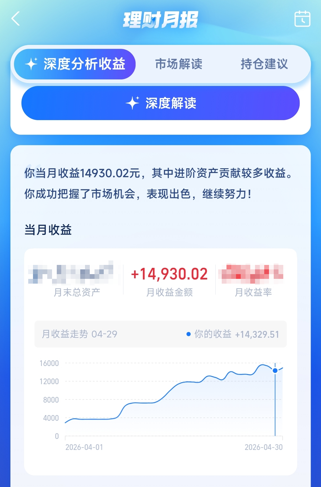
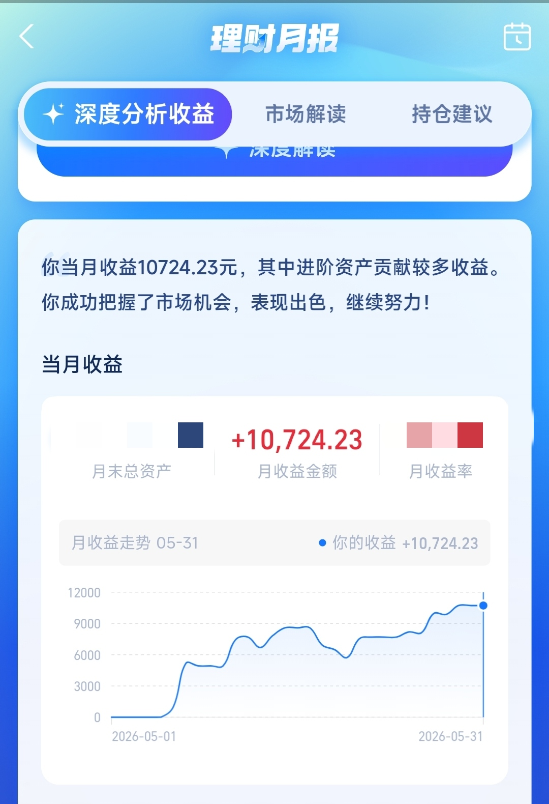

## 2026-05-12

_我回来了，带着一颗平静一些的心_

后续会更新一些我以后可能会忘记的内容，等我年纪上去了用来回忆，主要是以下几个方向：
- 我是个什么样的人
- 我的童年、校园经历
- 毕业至今的感想

挖坑给自己填

## 2026-05-22

_谁打断你的复利谁就是你的敌人_

1. 身体运动（✔）
2. 足够睡眠（✔）
3. 全身体检（今年待检2333）
4. 反脆弱心态（不要花过多时间在情绪上）
5. 大脑塑造（不要花过多时间在短视频上）
6. 可迁移技能（外语、演讲、辩论）
7. 每日阅读（30min）
8. 深度关系（能在你遇到重大挫折时，和你分担的人）
9. 储备资金（fxxk you money）
10. 独处能力（✔）
11. 清理社交（远离一直消耗你精力/情绪的人）
12. 复盘习惯（审视自己的一天）
13. 陌生旅行（接受全新环境的刺激）
14. 原谅自己（原谅偶尔的懒惰）

咳咳，最近“成功学”看的比较多的，摘录其中主旨相同的内容以后做成个专题

在线工具：[复利计算器](https://calctools.online/zh/finance/compound-interest)

本金7万块，年利率9%，投资60年，每月定投3000元，累计投入约220万，最终收益逾1亿元——由此看来贫富之间有一条线，一旦逾越，钱越花越多，这时候人的追求也许就变了，如何让财富永续，让后代能一直受这笔财富的福泽，或者追求更加宏观上的复利，创办慈善基金会等?_?

每个月3000块，定投三十年实现财富自由，听起来简单，实际上一点也不容易

在这三十年里，这笔资金只进不出（从中取钱是打断复利），能否保持稳定的现金流，哪怕是3000元，期间还得忍住不进行大笔消费，到55岁可以开始大笔消费了，我估计到那时已经消费不动了（笑）。之前还担心如果人人都这么做通货膨胀得多厉害，真正参与生产的人也会越来越少，现在看来真是多虑了，这点资产不仅不如头部富豪一根，而且还有机器人+AI替代劳动，未来真是一片光明啊！

也可以先复利个10~20年，等达到FIRE标准（有25倍年支出的存款在4%年化收益率的投资里）了就开始享受（大约40岁）

**看来当前最紧要的还是提升自己，把本金池子做大，提高收入**

## 2026-05-24

没有白学的英语，没有白学的技术，遇到问题多做笔记之后真能排上用场

## 2026-05-26

原本以为要到30岁左右才能月入2万......

叠甲：过往收益不代表今后表现，浮盈不代表最终收益，市场有风险，投资需谨慎，不构成任何投资建议

六七月份收益又开始回调咯，另QDII额度又被下调了，拖延的复利是错失风口，该加快脚步了！

## 2026-05-26

思想不会在脑海中孕育成熟，它需要被表达成文字

## 2026-06-11

时间会奖励有耐心的人

## 2026-07-19

周日去健身前做了一番激烈的思想斗争，因不信邪又吃了某店的面，慢性肠炎吃出来了，一天跑三趟厕所......出门时天色已经完全暗下来了，半边天空还能看得清有薄薄的云，而通往健身房方向路上的天空则阴暗得难以看清，乌云像是黑色的垃圾袋兜着一大袋雨水，随时准备倾泻而下。当我走了约五分之一路程时，那片暗的发黑的天空突然闪烁了几下，并缓慢地传来了雷声，手机天气预报也显示，晚上9点有中雨。当我走了约五分之三路程时，闪电的光芒几乎将半边天空完全照亮，雷声依旧慢悠悠传来，这时我想到了谚语：“雷公先唱歌，有雨也不多。”一天不练更是烦，硬着头皮就是干。

健身完回去的路上，地面都还是干的，合着是一滴雨都没下下来。要是被那乌云和雷声吓倒了，今天也就练不成了。